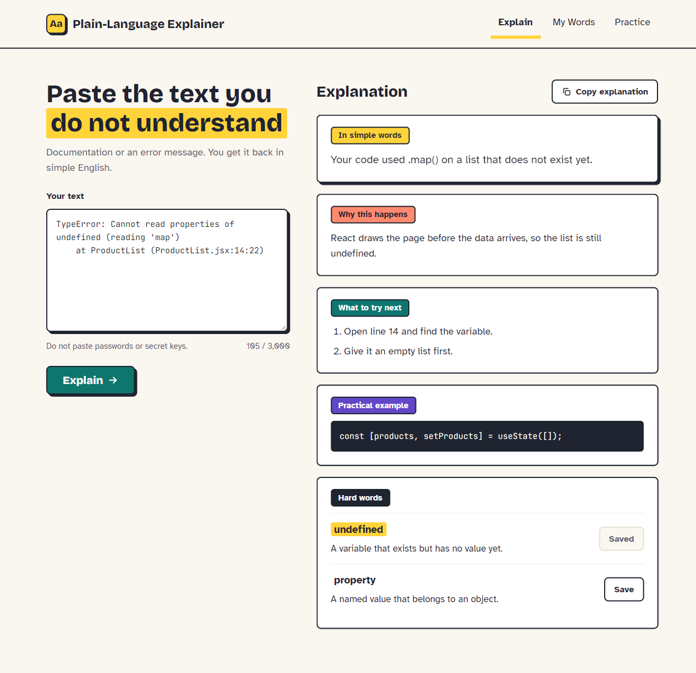

# Plain-Language Explainer

A web app for beginner developers who find technical English hard. Paste documentation or an error message and get it back in simple English: a short explanation, why it happens, what to try next, a practical example and the hard words. Save the hard words, then practise them with flashcards.



**Live site:** _add the Vercel link here after the first deploy_

## What it does

- **Explain** – paste up to 3,000 characters. One AI call returns five parts. "What to try next" appears only for error messages. Copy the whole answer as plain text.
- **My Words** – the words you saved, with meaning, source sentence and learning level. Search, delete, and export everything as a JSON file.
- **Practice** – flashcards from your saved words, up to ten per round, lowest level first. Space flips the card, `1` means "I forgot", `2` means "I knew it". A results screen lists the words to review.

No login, no database, no analytics. Saved words stay in your own browser (localStorage). Pasted text is sent to the AI to be explained and is not stored.

## Tech

- React with Vite, React Router
- Plain CSS with CSS variables
- One Vercel serverless function, `/api/explain`, that holds the Groq API key and checks the AI's answer
- Groq API on the Free plan, called with `fetch`
- Vitest and Testing Library

## Run it locally

```bash
npm install
cp .env.example .env.local   # then fill in GROQ_API_KEY and GROQ_MODEL
npx vercel dev               # serves the app and /api/explain on http://localhost:3000
```

`npm run dev` starts only the front end, so the Explain button will not work there. Get a free key at [console.groq.com](https://console.groq.com) and choose a model from the Free plan. Never put the key in `src/` or commit `.env.local`.

## Run the tests

```bash
npm test
```

The manual release checks are in [`docs/manual-checklist.md`](docs/manual-checklist.md).

## Project layout

- `src/` – the React app. `src/lib/wordStore.js` is the only file that touches localStorage.
- `api/explain.js` – thin Vercel adapter. `api/_lib/handleExplain.js` holds the request logic; `api/_lib/aiProvider.js` is the only file that knows about Groq.

## Ideas for version 2

Login and accounts, a difficulty selector and follow-up questions, more practice modes (multiple choice first), categories and word statistics, history of past explanations, other languages, dark mode.
